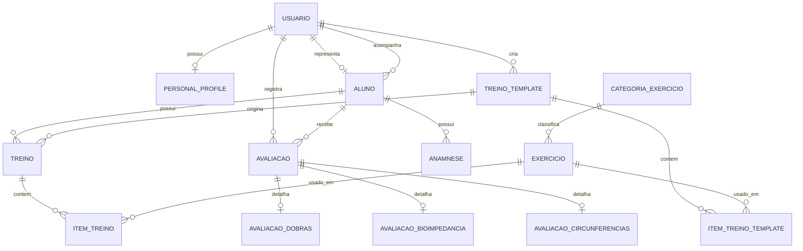

# Relatorio Academico FitSync

## 1. Visao geral do sistema

O FitSync e uma aplicacao para acompanhamento de treinos e avaliacoes fisicas em um ambiente de academia ou atendimento personalizado.

De forma simples, o sistema permite que:

- um administrador gerencie usuarios, personais, alunos e exercicios;
- um personal cadastre alunos, monte treinos, registre avaliacoes fisicas e acompanhe a evolucao;
- um aluno veja seus treinos, avaliacoes, resumo fisico e historico de evolucao.

O foco do trabalho de Banco de Dados esta nas tabelas, relacionamentos, operacoes CRUD e relatorios gerados a partir dos dados armazenados.

## 2. O que o FitSync faz

O sistema trabalha com tres perfis principais:

- **Admin**: administra a plataforma, usuarios, personais, alunos, categorias e exercicios.
- **Personal**: gerencia os proprios alunos, treinos, templates de treino, avaliacoes fisicas, anamnese e relatorios.
- **Aluno**: consulta os proprios dados, treino atual, avaliacoes e evolucao.

Os principais modulos da aplicacao sao:

- **accounts**: usuarios, personais, alunos, login, permissoes e dashboards.
- **workouts**: categorias de exercicio, exercicios, templates de treino, treinos e itens de treino.
- **assessments**: avaliacoes fisicas, dobras, bioimpedancia, circunferencias, anamnese, evolucao e ranking.
- **core**: configuracoes gerais, health check, opcoes do sistema e documentacao da API.

## 3. Stack usada

### 3.1 Backend

O backend esta no projeto `fitsync-api` e usa:

- **Python 3.12** como linguagem principal.
- **Django 6** como framework web.
- **Django REST Framework** para criar a API REST.
- **Django ORM** para mapear classes Python para tabelas do banco.
- **PostgreSQL 16** como banco de dados.
- **psycopg** como driver de conexao entre Django e PostgreSQL.
- **SimpleJWT** para autenticacao com tokens JWT.
- **Daphne/ASGI** para executar a aplicacao.
- **django-cors-headers** para liberar comunicacao com o frontend.
- **drf-spectacular** para gerar OpenAPI, Swagger e Redoc.
- **Poetry** para gerenciar dependencias.
- **Docker Compose** para subir o PostgreSQL local.

Arquivos importantes:

- `config/settings.py`: configuracoes do Django e conexao com banco.
- `docker-compose.yml`: servico PostgreSQL.
- `apps/*/models.py`: modelos que viram tabelas.
- `apps/*/migrations/`: historico de mudancas do banco.
- `apps/*/views.py`: endpoints e consultas ORM.
- `apps/*/serializers.py`: conversao entre objetos Python e JSON.

### 3.2 Frontend

O frontend esta no projeto irmao `/home/dev/fitsync` e usa:

- **Next.js 16** como framework frontend.
- **React 19** para componentes de interface.
- **TypeScript** para tipagem.
- **Axios** para chamadas HTTP para a API.
- **TanStack Query** para buscar, armazenar em cache e atualizar dados da API.
- **Recharts** para graficos de evolucao e ranking.
- **Tailwind CSS / shadcn** para componentes visuais.
- **openapi-typescript** para gerar tipos TypeScript a partir da API do backend.

Arquivos importantes no frontend:

- `src/lib/api/http.ts`: configuracao do Axios.
- `src/features/assessments/api/assessments.api.ts`: chamadas para avaliacoes, evolucao e ranking.
- `src/features/assessments/hooks/use-assessments.ts`: hooks que buscam relatorios com TanStack Query.
- `src/features/assessments/components/personal-evolution-page.tsx`: tela de evolucao do aluno para personal.
- `src/features/assessments/components/student-evolution-page.tsx`: tela de evolucao do aluno.
- `src/features/assessments/components/personal-ranking-page.tsx`: tela de ranking.
- `src/features/accounts/components/admin-dashboard.tsx`: dashboard admin.
- `src/features/accounts/components/personal-dashboard.tsx`: dashboard personal.

## 4. Banco de Dados explicado para o grupo

Esta secao foi escrita pensando em quem ainda nao tem familiaridade com banco de dados e ORM.

### 4.1 O que e uma tabela

Uma tabela e como uma planilha dentro do banco.

Exemplo: a tabela `usuario` guarda dados de usuarios.

Cada linha e um usuario. Cada coluna e uma informacao desse usuario.

Exemplo simplificado:

| id | nome | email | tipo |
| --- | --- | --- | --- |
| uuid-1 | Ana Personal | ana@email.com | PERSONAL |
| uuid-2 | Carlos Aluno | carlos@email.com | ALUNO |

### 4.2 O que e uma chave primaria

A chave primaria, ou **PK**, identifica uma linha de forma unica.

No FitSync, quase todas as tabelas principais usam `id` do tipo UUID como chave primaria.

Exemplo:

```text
usuario.id
aluno.id
exercicio.id
treino.id
avaliacao.id
```

Isso significa que dois usuarios diferentes nunca terao o mesmo `id`.

### 4.3 O que e uma chave estrangeira

A chave estrangeira, ou **FK**, liga uma tabela a outra.

Exemplo real do FitSync:

- a tabela `aluno` tem o campo `usuario_id`;
- esse campo aponta para `usuario.id`;
- assim o banco sabe qual usuario representa aquele aluno.

Outro exemplo:

- a tabela `treino` tem `aluno_id`;
- esse campo aponta para `aluno.id`;
- assim o banco sabe de qual aluno e aquele treino.

### 4.4 O que e relacionamento 1:1

Relacionamento 1:1 significa que um registro de uma tabela se liga a no maximo um registro de outra tabela.

Exemplo no FitSync:

- um `Usuario` do tipo aluno tem um unico `Aluno`;
- um `Aluno` pertence a um unico `Usuario`.

No Django isso aparece como:

```python
usuario = models.OneToOneField(
    settings.AUTH_USER_MODEL,
    on_delete=models.CASCADE,
    related_name="aluno",
)
```

### 4.5 O que e relacionamento 1:N

Relacionamento 1:N significa "um para muitos".

Exemplo no FitSync:

- um personal pode ter varios alunos;
- cada aluno pertence a um personal.

No Django isso aparece como:

```python
personal = models.ForeignKey(
    settings.AUTH_USER_MODEL,
    on_delete=models.PROTECT,
    related_name="alunos",
)
```

Outro exemplo:

- um aluno pode ter varios treinos;
- cada treino pertence a um aluno.

### 4.6 O que e relacionamento N:N

Relacionamento N:N significa "muitos para muitos".

No recorte principal do FitSync, a modelagem evita um N:N direto entre treino e exercicio criando uma tabela intermediaria chamada `item_treino`.

Na pratica:

- um treino tem varios itens;
- cada item aponta para um exercicio;
- assim um mesmo exercicio pode aparecer em varios treinos.

Isso e parecido com uma tabela associativa, porque `item_treino` liga `treino` e `exercicio` e ainda guarda informacoes extras, como series, repeticoes, descanso e ordem.

### 4.7 O que e DDL

DDL significa **Data Definition Language**.

Sao comandos SQL usados para criar ou alterar a estrutura do banco.

Exemplos:

```sql
CREATE TABLE usuario (...);
ALTER TABLE avaliacao ADD COLUMN imc NUMERIC(5, 2);
DROP TABLE alguma_tabela;
```

No FitSync, esses comandos nao sao escritos manualmente no codigo principal. O Django gera e aplica isso por migrations.

### 4.8 O que e DML

DML significa **Data Manipulation Language**.

Sao comandos SQL usados para mexer nos dados dentro das tabelas.

Exemplos:

```sql
SELECT * FROM usuario;
INSERT INTO exercicio (...);
UPDATE treino SET ativo = false WHERE id = '...';
DELETE FROM item_treino WHERE treino_id = '...';
```

No FitSync, esses comandos tambem sao feitos pela ORM do Django.

### 4.9 O que e ORM

ORM significa **Object Relational Mapper**.

Em linguagem simples: ORM e uma camada que deixa o programador trabalhar com classes e objetos em Python, enquanto o Django transforma isso em SQL para o banco.

Exemplo mental:

```text
Codigo Python com Django ORM
        |
        v
Django transforma em SQL
        |
        v
PostgreSQL executa no banco
```

Entao, quando o codigo faz:

```python
Aluno.objects.filter(personal=request.user)
```

O Django entende que precisa consultar a tabela `aluno` no banco e gerar um SQL equivalente a:

```sql
SELECT *
FROM aluno
WHERE personal_id = 'id-do-personal';
```

## 5. Como o Django ORM modela o banco por baixo dos panos

No Django, cada classe que herda de `models.Model` representa uma tabela.

Exemplo real simplificado:

```python
class Exercicio(models.Model):
    id = models.UUIDField(primary_key=True)
    nome = models.CharField(max_length=120)
    grupo_muscular = models.CharField(max_length=80)
    ativo = models.BooleanField(default=True)
```

Esse model indica para o Django que existe uma tabela com colunas parecidas com:

```sql
CREATE TABLE exercicio (
    id uuid PRIMARY KEY,
    nome varchar(120) NOT NULL,
    grupo_muscular varchar(80) NOT NULL,
    ativo boolean NOT NULL
);
```

### 5.1 Campos Django e colunas SQL

Alguns exemplos importantes:

| Django ORM | Banco de dados |
| --- | --- |
| `CharField(max_length=120)` | texto limitado, como `varchar(120)` |
| `TextField()` | texto longo |
| `EmailField(unique=True)` | texto de email com restricao unica |
| `DateField()` | data |
| `DateTimeField(auto_now_add=True)` | data e hora de criacao |
| `DecimalField(max_digits=5, decimal_places=2)` | numero decimal |
| `BooleanField(default=True)` | verdadeiro/falso |
| `UUIDField(primary_key=True)` | UUID como chave primaria |
| `ForeignKey(...)` | chave estrangeira |
| `OneToOneField(...)` | relacao um para um |

### 5.2 Migrations: o historico do banco

As migrations sao arquivos que registram como o banco deve ser criado ou alterado.

Fluxo simples:

1. O desenvolvedor altera um arquivo `models.py`.
2. O Django gera uma migration.
3. O comando `python manage.py migrate` aplica essa migration no PostgreSQL.
4. O banco recebe comandos equivalentes a `CREATE TABLE`, `ALTER TABLE`, criacao de FKs e constraints.

No projeto, exemplos de migrations sao:

- `apps/accounts/migrations/0001_initial.py`
- `apps/workouts/migrations/0001_initial.py`
- `apps/assessments/migrations/0001_initial.py`
- `apps/core/migrations/0001_initial.py`
- `apps/accounts/migrations/0003_personalprofile.py`
- `apps/workouts/migrations/0004_categoria_exercicio.py`
- `apps/assessments/migrations/0003_assessment_metrics_bilateral_anamnese.py`

### 5.3 Exemplo de DDL gerado por migration

No model `Aluno`, existe uma relacao com `Usuario` e uma relacao com o personal responsavel.

Trecho simplificado em Django:

```python
class Aluno(models.Model):
    usuario = models.OneToOneField(
        settings.AUTH_USER_MODEL,
        on_delete=models.CASCADE,
        related_name="aluno",
    )
    personal = models.ForeignKey(
        settings.AUTH_USER_MODEL,
        on_delete=models.PROTECT,
        related_name="alunos",
    )
    data_nascimento = models.DateField()
    sexo = models.CharField(max_length=1)
```

SQL equivalente para entender:

```sql
CREATE TABLE aluno (
    id uuid PRIMARY KEY,
    usuario_id uuid NOT NULL UNIQUE,
    personal_id uuid NOT NULL,
    data_nascimento date NOT NULL,
    sexo varchar(1) NOT NULL,
    objetivo_principal varchar(120) NOT NULL,
    observacoes_medicas text NOT NULL,
    CONSTRAINT aluno_usuario_fk
        FOREIGN KEY (usuario_id) REFERENCES usuario(id),
    CONSTRAINT aluno_personal_fk
        FOREIGN KEY (personal_id) REFERENCES usuario(id)
);
```

Observacao importante: `CASCADE`, `PROTECT` e `SET_NULL` sao regras que o Django usa quando a exclusao passa pela ORM. A chave estrangeira tambem existe no banco para manter integridade.

## 6. DER conceitual

O DER conceitual mostra as entidades principais e como elas se relacionam, sem se preocupar tanto com tipos exatos de colunas.

Entidades principais:

- **Usuario**: representa admin, personal ou aluno.
- **PersonalProfile**: dados extras de um usuario personal.
- **Aluno**: dados especificos de um aluno.
- **CategoriaExercicio**: categoria ou grupo do exercicio.
- **Exercicio**: exercicio disponivel no catalogo.
- **TreinoTemplate**: modelo de treino criado por um personal.
- **ItemTreinoTemplate**: exercicios dentro de um template.
- **Treino**: treino aplicado a um aluno.
- **ItemTreino**: exercicios dentro de um treino aplicado.
- **Avaliacao**: avaliacao fisica do aluno.
- **AvaliacaoDobras**: dados de dobras cutaneas.
- **AvaliacaoBioimpedancia**: dados de bioimpedancia.
- **AvaliacaoCircunferencias**: medidas corporais.
- **Anamnese**: historico de saude e restricoes do aluno.

Relacionamentos principais:

- Um usuario personal pode ter um perfil de personal.
- Um usuario aluno tem um perfil de aluno.
- Um personal possui varios alunos.
- Um aluno pertence a um personal.
- Uma categoria possui varios exercicios.
- Um exercicio pertence a uma categoria.
- Um personal cria varios templates de treino.
- Um template possui varios itens de template.
- Um item de template aponta para um exercicio.
- Um aluno possui varios treinos.
- Um treino possui varios itens.
- Um item de treino aponta para um exercicio.
- Um aluno possui varias avaliacoes.
- Uma avaliacao pertence a um aluno e a um personal.
- Uma avaliacao pode ter dados de dobras, bioimpedancia e/ou circunferencias.
- Um aluno pode ter anamneses, mas somente uma anamnese ativa por vez.

### 6.1 DER conceitual em Mermaid



## 7. Modelo logico

O modelo logico ja se aproxima mais do banco real. Aqui aparecem tabelas, chaves primarias, chaves estrangeiras e campos principais.

### 7.1 Tabela `usuario`

Representa todos os usuarios do sistema.

Campos principais:

- `id`: PK, UUID.
- `nome`: nome do usuario.
- `email`: email unico.
- `tipo`: `ADMIN`, `PERSONAL` ou `ALUNO`.
- `is_active`: indica se o usuario esta ativo.
- `is_staff`: usado pelo admin Django.
- `data_criacao`: data de criacao.

Regras:

- `email` e unico.
- Existe constraint para email unico sem diferenciar maiusculas e minusculas.

### 7.2 Tabela `personal_profile`

Guarda dados extras do personal.

Campos principais:

- `id`: PK, UUID.
- `usuario_id`: FK para `usuario`.
- `especialidade`: especialidade do personal.
- `bio`: biografia.
- `data_criacao`
- `data_atualizacao`

Relacionamento:

- `usuario` 1:1 `personal_profile`.

### 7.3 Tabela `aluno`

Guarda dados especificos de alunos.

Campos principais:

- `id`: PK, UUID.
- `usuario_id`: FK unica para `usuario`.
- `personal_id`: FK para `usuario` do tipo personal.
- `data_nascimento`
- `sexo`
- `objetivo_principal`
- `observacoes_medicas`

Relacionamentos:

- `usuario` 1:1 `aluno`.
- `personal` 1:N `aluno`.

### 7.4 Tabela `categoria_exercicio`

Guarda categorias de exercicios.

Campos principais:

- `id`: PK, UUID.
- `nome`: nome unico da categoria.
- `slug`: identificador textual unico.
- `ativo`: indica se aparece no sistema.
- `ordem`: ordenacao.
- `data_criacao`

Relacionamento:

- uma categoria tem varios exercicios.

### 7.5 Tabela `exercicio`

Guarda exercicios do catalogo.

Campos principais:

- `id`: PK, UUID.
- `nome`: nome do exercicio.
- `slug`: identificador textual.
- `categoria_id`: FK para `categoria_exercicio`.
- `grupo_muscular`
- `url_animacao`
- `instrucoes_gerais`
- `status`: `PENDENTE`, `APROVADO` ou `REJEITADO`.
- `origem`: `MANUAL` ou `WGER`.
- `ativo`
- `data_criacao`

Regras:

- nome unico sem diferenciar maiusculas e minusculas.
- exercicios podem ser arquivados com `ativo = false`.

### 7.6 Tabela `treino_template`

Guarda modelos de treino criados por personais.

Campos principais:

- `id`: PK, UUID.
- `personal_id`: FK para `usuario`.
- `titulo`
- `descricao`
- `ativo`
- `data_criacao`

Relacionamento:

- um personal tem varios templates.
- um template tem varios itens.

### 7.7 Tabela `item_treino_template`

Guarda os exercicios de um template.

Campos principais:

- `id`: PK, UUID.
- `template_id`: FK para `treino_template`.
- `exercicio_id`: FK para `exercicio`.
- `series`
- `repeticoes`
- `descanso_segundos`
- `ordem_execucao`

Regra:

- a combinacao `template_id + ordem_execucao` e unica.

### 7.8 Tabela `treino`

Guarda treinos aplicados a alunos.

Campos principais:

- `id`: PK, UUID.
- `aluno_id`: FK para `aluno`.
- `template_origem_id`: FK opcional para `treino_template`.
- `titulo`
- `dia_da_semana`
- `data_inicio`
- `data_vencimento`
- `ativo`
- `data_criacao`

Regra de negocio:

- quando um treino novo e ativado para um aluno, o Django desativa os outros treinos ativos daquele aluno.

### 7.9 Tabela `item_treino`

Guarda os exercicios dentro de um treino aplicado.

Campos principais:

- `id`: PK, UUID.
- `treino_id`: FK para `treino`.
- `exercicio_id`: FK para `exercicio`.
- `series`
- `repeticoes`
- `descanso_segundos`
- `ordem_execucao`

Regra:

- a combinacao `treino_id + ordem_execucao` e unica.

### 7.10 Tabela `avaliacao`

Guarda avaliacoes fisicas.

Campos principais:

- `id`: PK, UUID.
- `aluno_id`: FK para `aluno`.
- `personal_id`: FK para `usuario`.
- `metodo`: `DOBRAS`, `BIOIMPEDANCIA`, `CIRCUNFERENCIAS` ou `COMBINADO`.
- `data_avaliacao`
- `peso_kg`
- `altura_cm`
- `densidade_corporal`
- `percentual_gordura`
- `massa_gorda_kg`
- `massa_magra_kg`
- `imc`
- `iac`
- `rcq`
- `data_proxima_avaliacao`
- `feedback_personal`
- `ativo`
- `data_criacao`
- `data_atualizacao`

Relacionamentos:

- um aluno tem varias avaliacoes.
- um personal registra varias avaliacoes.

### 7.11 Tabelas especializadas de avaliacao

O FitSync separa alguns dados especificos em tabelas proprias:

- `avaliacao_dobras`
- `avaliacao_bioimpedancia`
- `avaliacao_circunferencias`

Cada uma tem relacao 1:1 com `avaliacao`.

Isso evita colocar todos os campos possiveis em uma unica tabela muito grande e permite guardar dados diferentes conforme o metodo da avaliacao.

### 7.12 Tabela `anamnese`

Guarda informacoes de historico de saude do aluno.

Campos principais:

- `id`: PK, UUID.
- `aluno_id`: FK para `aluno`.
- `historico_familiar`
- `doencas_preexistentes`
- `lesoes`
- `medicamentos`
- `alergias`
- `cirurgias`
- `restricoes_exercicio`
- `observacoes`
- `ativo`
- `data_criacao`
- `data_atualizacao`

Regra:

- existe uma constraint para permitir somente uma anamnese ativa por aluno.

## 8. Como o CRUD aparece no sistema

CRUD significa:

- **Create**: criar dados.
- **Read**: ler/listar dados.
- **Update**: atualizar dados.
- **Delete**: excluir dados.

No FitSync, o CRUD e feito principalmente por endpoints da API REST.

### 8.1 Create

Exemplo real: criar treino.

No Django ORM:

```python
treino = Treino.objects.create(**validated_data)
ItemTreino.objects.bulk_create([
    ItemTreino(treino=treino, **item)
    for item in itens_data
])
```

SQL equivalente:

```sql
INSERT INTO treino (id, aluno_id, titulo, data_inicio, ativo)
VALUES ('uuid-treino', 'uuid-aluno', 'Treino A', '2026-01-01', true);

INSERT INTO item_treino (id, treino_id, exercicio_id, series, repeticoes, descanso_segundos, ordem_execucao)
VALUES ('uuid-item', 'uuid-treino', 'uuid-exercicio', 3, '12', 45, 1);
```

### 8.2 Read

Exemplo real: listar avaliacoes ativas de um aluno.

No Django ORM:

```python
Avaliacao.objects.filter(aluno=aluno, ativo=True)
```

SQL equivalente:

```sql
SELECT *
FROM avaliacao
WHERE aluno_id = 'uuid-aluno'
  AND ativo = true;
```

### 8.3 Update

Exemplo real: arquivar um exercicio.

No Django ORM:

```python
exercicio.ativo = False
exercicio.save(update_fields=["ativo"])
```

SQL equivalente:

```sql
UPDATE exercicio
SET ativo = false
WHERE id = 'uuid-exercicio';
```

### 8.4 Delete

Nos cadastros principais, o FitSync normalmente nao apaga fisicamente o registro. Ele usa **soft delete**, ou arquivamento.

Exemplo:

```python
treino.ativo = False
treino.save(update_fields=["ativo"])
```

SQL equivalente:

```sql
UPDATE treino
SET ativo = false
WHERE id = 'uuid-treino';
```

Mas existe exclusao fisica em itens filhos de treino quando a lista de itens e substituida:

```python
instance.itens.all().delete()
```

SQL equivalente:

```sql
DELETE FROM item_treino
WHERE treino_id = 'uuid-treino';
```

Esse delete e usado em dados dependentes, nao nos cadastros principais.

## 9. Criterios de Banco de Dados atendidos

### 9.1 SQL DDL e ORM

O requisito de DDL e ORM esta atendido porque:

- a aplicacao usa Django ORM;
- as classes em `models.py` modelam as tabelas;
- as migrations geram a estrutura do banco;
- o comando `python manage.py migrate` aplica as alteracoes no PostgreSQL.

Exemplos de DDL representados nas migrations:

- `CreateModel`: equivale a `CREATE TABLE`.
- `AddField`: equivale a `ALTER TABLE ADD COLUMN`.
- `AlterField`: equivale a `ALTER TABLE ALTER COLUMN`.
- `RemoveField`: equivale a `ALTER TABLE DROP COLUMN`.
- `UniqueConstraint`: equivale a `UNIQUE`.
- `ForeignKey`: equivale a `FOREIGN KEY`.

### 9.2 SQL DML e ORM

O requisito de DML esta atendido porque a aplicacao executa operacoes equivalentes a:

- `SELECT`: com `.filter()`, `.get()`, `.all()`, `.first()`, `.last()`.
- `INSERT`: com `.create()` e `.bulk_create()`.
- `UPDATE`: com `.save(update_fields=[...])`, `.update()` e `.update_or_create()`.
- `DELETE`: com `.delete()` em itens filhos de treino.

Exemplos reais no projeto:

- `Usuario.objects.create_user(...)`
- `Aluno.objects.create(...)`
- `Avaliacao.objects.create(...)`
- `Treino.objects.filter(...).update(...)`
- `Exercicio.objects.filter(...).update(...)`
- `instance.itens.all().delete()`

## 10. Comandos de relatorio implementados

O enunciado pede pelo menos 3 comandos de relatorio, como `where`, `count`, `min`, `max`, `like`, sendo pelo menos um com `join`.

No FitSync, existem mais de 3. Os principais sao `WHERE`, `COUNT`, `LIKE` e `JOIN`.

### 10.1 WHERE

`WHERE` aparece quando filtramos dados.

Exemplo real: filtrar avaliacoes por periodo.

No Django ORM:

```python
if data_inicio:
    queryset = queryset.filter(data_avaliacao__gte=data_inicio)
if data_fim:
    queryset = queryset.filter(data_avaliacao__lte=data_fim)
```

SQL equivalente:

```sql
SELECT *
FROM avaliacao
WHERE data_avaliacao >= '2026-01-01'
  AND data_avaliacao <= '2026-02-01';
```

Tambem aparecem filtros por:

- aluno;
- personal;
- ativo;
- status;
- metodo de avaliacao;
- categoria de exercicio.

### 10.2 COUNT

`COUNT` aparece nos dashboards e metricas.

Exemplo real do dashboard admin:

```python
users_active = non_admin_users.filter(is_active=True).count()
Treino.objects.filter(ativo=True).count()
Avaliacao.objects.filter(ativo=True, data_avaliacao__gte=cutoff).count()
```

SQL equivalente:

```sql
SELECT COUNT(*)
FROM treino
WHERE ativo = true;
```

Outro exemplo real: metricas de personais com `annotate`.

```python
queryset.annotate(
    alunos_count=Count("alunos", distinct=True),
    treinos_count=Count("alunos__treinos", distinct=True),
    avaliacoes_count=Count("alunos__avaliacoes", distinct=True),
)
```

SQL equivalente simplificado:

```sql
SELECT
    usuario.id,
    usuario.nome,
    COUNT(DISTINCT aluno.id) AS alunos_count,
    COUNT(DISTINCT treino.id) AS treinos_count,
    COUNT(DISTINCT avaliacao.id) AS avaliacoes_count
FROM usuario
LEFT JOIN aluno ON aluno.personal_id = usuario.id
LEFT JOIN treino ON treino.aluno_id = aluno.id
LEFT JOIN avaliacao ON avaliacao.aluno_id = aluno.id
WHERE usuario.tipo = 'PERSONAL'
GROUP BY usuario.id;
```

Esse e um dos melhores exemplos para explicar agregacao e join ao professor.

### 10.3 LIKE

`LIKE` aparece nas buscas por texto.

No Django, o projeto usa `icontains`, que equivale a uma busca do tipo `LIKE`, ignorando maiusculas e minusculas.

Exemplo real:

```python
queryset = queryset.filter(
    Q(usuario__nome__icontains=search)
    | Q(usuario__email__icontains=search)
    | Q(objetivo_principal__icontains=search)
    | Q(personal__nome__icontains=search)
)
```

SQL equivalente:

```sql
SELECT aluno.*
FROM aluno
JOIN usuario AS usuario_aluno ON usuario_aluno.id = aluno.usuario_id
JOIN usuario AS usuario_personal ON usuario_personal.id = aluno.personal_id
WHERE usuario_aluno.nome ILIKE '%ana%'
   OR usuario_aluno.email ILIKE '%ana%'
   OR aluno.objetivo_principal ILIKE '%ana%'
   OR usuario_personal.nome ILIKE '%ana%';
```

No PostgreSQL, `ILIKE` e parecido com `LIKE`, mas ignora diferenca entre maiusculas e minusculas.

### 10.4 JOIN

`JOIN` aparece quando o sistema precisa juntar dados de mais de uma tabela.

No Django, isso aparece com:

- `select_related(...)`
- `prefetch_related(...)`
- filtros atravessando relacoes, como `aluno__usuario`
- agregacoes atravessando relacoes, como `Count("alunos__treinos")`

Exemplo real:

```python
Treino.objects.select_related(
    "aluno__usuario",
    "aluno__personal",
    "template_origem",
).prefetch_related("itens__exercicio")
```

SQL equivalente simplificado:

```sql
SELECT treino.*, aluno.*, usuario_aluno.*, usuario_personal.*, treino_template.*
FROM treino
JOIN aluno ON aluno.id = treino.aluno_id
JOIN usuario AS usuario_aluno ON usuario_aluno.id = aluno.usuario_id
JOIN usuario AS usuario_personal ON usuario_personal.id = aluno.personal_id
LEFT JOIN treino_template ON treino_template.id = treino.template_origem_id;
```

Esse exemplo mostra como o treino vem junto com os dados do aluno, do personal e do template de origem.

## 11. Relatorios reais do FitSync

### 11.1 Dashboard admin

Rota:

```text
GET /api/accounts/admin/dashboard/
```

O que mostra:

- total de usuarios;
- usuarios ativos e inativos;
- personais;
- alunos;
- exercicios;
- treinos ativos;
- avaliacoes recentes.

Como funciona:

- usa filtros com `.filter(...)`;
- usa contagens com `.count()`;
- retorna JSON para o frontend.

Frontend:

- `AdminDashboard`
- cards com indicadores operacionais.

### 11.2 Dashboard personal

Rota:

```text
GET /api/accounts/personal/dashboard/
```

O que mostra:

- alunos do personal;
- alunos ativos;
- treinos;
- avaliacoes;
- ranking resumido de evolucao.

Como funciona:

- filtra alunos por `personal=request.user`;
- conta treinos e avaliacoes;
- monta ranking comparando primeira e ultima avaliacao de cada aluno.

Frontend:

- `PersonalDashboard`
- cards e lista de melhores variacoes.

### 11.3 Evolucao do aluno

Rotas:

```text
GET /api/assessments/alunos/<id>/evolucao/
GET /api/assessments/me/evolucao/
```

O que mostra:

- historico de avaliacoes;
- peso;
- IMC;
- IAC;
- percentual de gordura;
- massa gorda;
- massa magra;
- RCQ;
- deltas entre uma avaliacao e a anterior.

Como funciona:

- busca avaliacoes ativas do aluno;
- ordena por data;
- calcula diferencas entre os registros;
- retorna uma lista pronta para tabela e grafico.

Frontend:

- `PersonalEvolutionPage`
- `StudentEvolutionPage`
- graficos de linha com Recharts.

### 11.4 Ranking de evolucao

Rota:

```text
GET /api/assessments/personal/ranking/
```

O que mostra:

- alunos com pelo menos duas avaliacoes;
- percentual de gordura inicial;
- percentual de gordura final;
- variacao do percentual de gordura.

Como funciona:

- pega alunos do personal;
- busca avaliacoes ativas com percentual de gordura;
- compara primeira e ultima avaliacao no periodo;
- ordena pelo melhor resultado.

Frontend:

- `PersonalRankingPage`
- grafico de barras com Recharts.

### 11.5 Listagens filtradas

Tambem existem listagens que funcionam como consultas de relatorio:

- alunos por personal;
- exercicios por categoria, status, origem e busca;
- treinos por aluno e ativo;
- avaliacoes por aluno, metodo, ativo e periodo.

Essas listagens usam `WHERE`, `LIKE`, `JOIN` e paginacao.

## 12. Como os relatorios chegam no frontend

O frontend nao acessa o banco diretamente.

Fluxo real:

```text
Usuario abre uma tela no Next.js
        |
        v
Componente React chama um hook
        |
        v
TanStack Query executa uma funcao de API
        |
        v
Axios chama o backend Django
        |
        v
Django consulta o banco com ORM
        |
        v
Django REST Framework transforma em JSON
        |
        v
Frontend renderiza cards, tabelas e graficos
```

Exemplo no frontend:

```typescript
export function usePersonalRanking(params?: EvolutionParams) {
  return useQuery({
    queryKey: personalRankingQueryKey(params),
    queryFn: () => getPersonalRanking(params),
  });
}
```

Essa funcao chama:

```typescript
http.get<PersonalRankingResponse>("/api/assessments/personal/ranking/", {
  params,
});
```

No backend, a rota executa consultas ORM, monta o ranking e devolve JSON.

O React recebe esse JSON e o componente `PersonalRankingPage` mostra tabela e grafico.

## 13. Por que nao precisamos escrever SQL manualmente

A aplicacao nao escreve SQL manual no codigo comum porque usa Django ORM.

Isso nao significa que nao existe SQL.

O que acontece e:

1. O programador escreve Python.
2. O Django ORM interpreta os models e QuerySets.
3. O Django gera SQL.
4. O PostgreSQL executa o SQL.
5. O resultado volta como objetos Python.

Exemplo:

```python
Exercicio.objects.filter(ativo=True, status=Exercicio.Status.APROVADO)
```

SQL equivalente:

```sql
SELECT *
FROM exercicio
WHERE ativo = true
  AND status = 'APROVADO';
```

Vantagens:

- menos repeticao de SQL;
- menos risco de erro de digitacao em consultas simples;
- integracao com validacoes e relacionamentos do Django;
- migrations organizam o historico do banco;
- codigo fica mais facil de manter.

Ponto importante para falar na apresentacao:

> A ORM nao substitui o banco. Ela e uma camada entre o codigo Python e o banco PostgreSQL. O SQL continua existindo, mas e gerado pelo framework.

## 14. Perguntas que o professor pode fazer

### 14.1 Se voces nao escrevem SQL, onde o SQL acontece?

O SQL e gerado pelo Django ORM.

Quando usamos comandos como `.filter()`, `.create()`, `.update()` e `.delete()`, o Django monta SQL equivalente e envia para o PostgreSQL.

### 14.2 Como a tabela e criada?

A tabela e criada por migrations.

O model em `models.py` define a estrutura. A migration registra essa estrutura. O comando `python manage.py migrate` aplica isso no banco com comandos equivalentes a `CREATE TABLE` e `ALTER TABLE`.

### 14.3 Como o Django sabe que `Aluno` se relaciona com `Usuario`?

Porque no model `Aluno` existe um campo:

```python
usuario = models.OneToOneField(settings.AUTH_USER_MODEL, ...)
```

Esse campo vira uma FK no banco e indica que o aluno esta ligado a um usuario.

### 14.4 O que e uma migration?

Migration e um arquivo que guarda uma mudanca na estrutura do banco.

Ela funciona como um historico: cria tabela, adiciona campo, remove campo, altera tipo, cria constraint e assim por diante.

### 14.5 Onde aparece um JOIN?

Aparece quando usamos `select_related`, `prefetch_related` ou quando atravessamos relacionamentos.

Exemplo:

```python
Aluno.objects.select_related("usuario", "personal")
```

Isso faz o Django buscar dados de `aluno` junto com dados da tabela `usuario`.

### 14.6 Onde aparece um COUNT?

Aparece nos dashboards e metricas.

Exemplo:

```python
Treino.objects.filter(ativo=True).count()
```

SQL equivalente:

```sql
SELECT COUNT(*)
FROM treino
WHERE ativo = true;
```

### 14.7 Onde acontece INSERT?

Acontece quando criamos registros.

Exemplo:

```python
Avaliacao.objects.create(...)
```

SQL equivalente:

```sql
INSERT INTO avaliacao (...) VALUES (...);
```

### 14.8 Onde acontece SELECT?

Acontece quando buscamos dados.

Exemplo:

```python
Avaliacao.objects.filter(aluno=aluno, ativo=True)
```

SQL equivalente:

```sql
SELECT *
FROM avaliacao
WHERE aluno_id = 'uuid-aluno'
  AND ativo = true;
```

### 14.9 Onde acontece UPDATE?

Acontece quando atualizamos registros.

Exemplo:

```python
Exercicio.objects.filter(id__in=ids).update(ativo=False)
```

SQL equivalente:

```sql
UPDATE exercicio
SET ativo = false
WHERE id IN (...);
```

### 14.10 Onde acontece DELETE?

Nos cadastros principais, normalmente nao apagamos fisicamente. Usamos arquivamento com `ativo = false`.

Mas em itens filhos de treino existe exclusao fisica:

```python
instance.itens.all().delete()
```

SQL equivalente:

```sql
DELETE FROM item_treino
WHERE treino_id = 'uuid-treino';
```

### 14.11 O que e soft delete?

Soft delete e quando o sistema nao apaga a linha do banco. Ele apenas marca como inativa.

Exemplo:

```sql
UPDATE exercicio
SET ativo = false
WHERE id = 'uuid-exercicio';
```

Isso preserva o historico e evita perder dados importantes.

### 14.12 Por que usar UUID como id?

UUID e um identificador grande e unico.

Ele evita sequencias previsiveis como `1`, `2`, `3` e reduz risco de conflito entre registros.

### 14.13 O que garante que um aluno pertence a um personal?

O campo `personal_id` na tabela `aluno`.

Ele aponta para a tabela `usuario`, onde o usuario precisa ser do tipo `PERSONAL`.

Essa regra e validada no Django pelos models e serializers.

### 14.14 O que garante que um item de treino pertence a um treino?

O campo `treino_id` na tabela `item_treino`.

Ele e uma chave estrangeira para `treino.id`.

### 14.15 O que garante que nao existam duas ordens iguais no mesmo treino?

A constraint:

```python
models.UniqueConstraint(
    fields=["treino", "ordem_execucao"],
    name="item_treino_ordem_unique",
)
```

SQL equivalente:

```sql
UNIQUE (treino_id, ordem_execucao)
```

## 15. Mini-glossario para o grupo

### API

E a ponte entre frontend e backend. O frontend pede dados para a API, e a API responde em JSON.

### Backend

Parte do sistema que roda no servidor. No FitSync, e o Django.

### Frontend

Parte visual usada pelo usuario. No FitSync, e o Next.js com React.

### Banco de dados

Local onde os dados ficam armazenados de forma organizada.

### PostgreSQL

Banco de dados relacional usado pelo FitSync.

### ORM

Camada que transforma codigo Python em SQL.

### Model

Classe Python que representa uma tabela do banco.

### Migration

Arquivo que registra uma mudanca na estrutura do banco.

### QuerySet

Objeto do Django que representa uma consulta ao banco.

Exemplo:

```python
Aluno.objects.filter(personal=request.user)
```

### Serializer

Parte do Django REST Framework que transforma objetos Python em JSON e tambem valida dados recebidos.

### Endpoint

Endereco da API.

Exemplo:

```text
GET /api/assessments/personal/ranking/
```

### JSON

Formato de dados usado para comunicacao entre frontend e backend.

### PK

Primary Key, ou chave primaria. Identifica uma linha da tabela.

### FK

Foreign Key, ou chave estrangeira. Liga uma tabela a outra.

### Constraint

Regra no banco ou na modelagem.

Exemplos:

- email unico;
- ordem unica dentro de um treino;
- uma anamnese ativa por aluno.

### JOIN

Consulta que junta dados de duas ou mais tabelas.

### COUNT

Contagem de registros.

### WHERE

Filtro da consulta.

### LIKE / ILIKE

Busca por texto. `ILIKE` ignora maiusculas e minusculas no PostgreSQL.

### Soft delete

Arquivamento logico. O dado nao e apagado; fica com `ativo = false`.

## 16. Conclusao

O FitSync atende aos pontos principais esperados em um trabalho de Banco de Dados:

- possui modelagem de entidades e relacionamentos;
- usa PostgreSQL como banco relacional;
- usa Django ORM para mapear classes para tabelas;
- usa migrations para criar e alterar a estrutura do banco;
- implementa operacoes equivalentes a DDL e DML;
- possui CRUD para usuarios, alunos, exercicios, treinos e avaliacoes;
- usa relatorios com filtros, contagens, buscas textuais e joins;
- exibe esses relatorios no frontend com cards, tabelas e graficos.

A frase principal para explicar a arquitetura e:

> O FitSync usa Django ORM como camada entre o codigo Python e o PostgreSQL. A gente escreve models e consultas em Python, e o Django gera os comandos SQL necessarios para criar tabelas, inserir, consultar, atualizar, excluir e montar relatorios.

